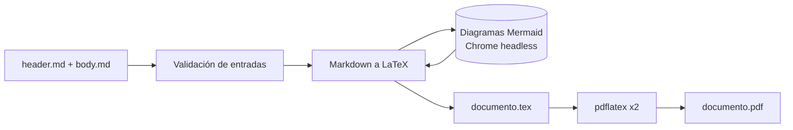
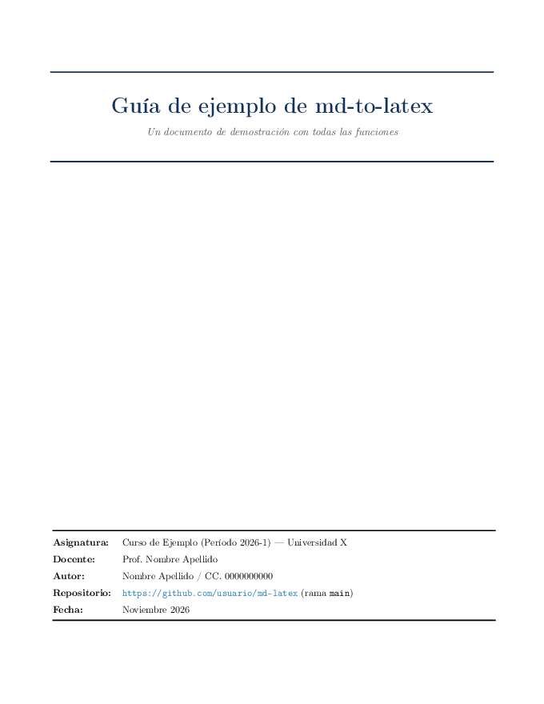
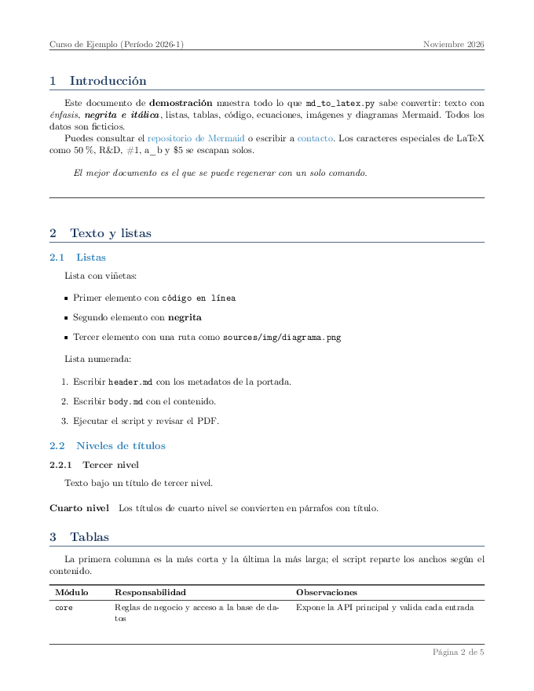
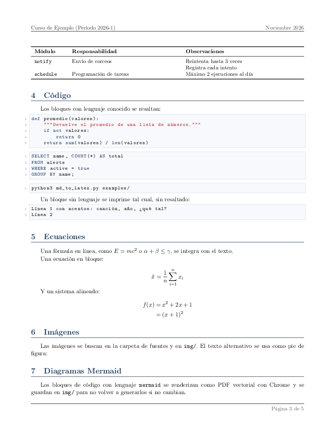
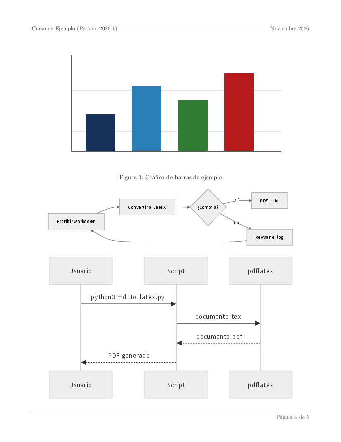

<div align="center">

# md-to-latex

**De Markdown a PDF con portada, índice y diagramas.**


[Inicio rápido](#inicio-rápido) · [Resultado](#resultado) · [Script](#uso-como-script) · [Librería](#uso-como-librería) · [Skill](#uso-como-skill) · [Seguridad](#seguridad)

</div>

---

**md-to-latex** transforma documentos escritos en Markdown en informes LaTeX listos para entregar: portada con tabla de metadatos, índice automático, encabezados, numeración de páginas y un PDF final, todo con un solo comando.

| Escribes | Obtienes |
|---|---|
| Texto, listas y tablas en Markdown | Documento LaTeX con formato profesional |
| Bloques de código y ecuaciones `$…$` | Código resaltado y matemáticas tipografiadas |
| Imágenes y bloques ` ```mermaid ` | Figuras con pie y diagramas en PDF vectorial |
| Un `header.md` con título, autor y fecha | Portada con índice y paginación |

Se usa de tres formas: como **script** de línea de comandos, como **librería** de Python o como **skill** para agentes de IA.



- Solo librería estándar de Python 3: no hay dependencias que instalar.
- Trata el Markdown como entrada no confiable: neutraliza la inyección de comandos LaTeX y de HTML en Mermaid (ver [Seguridad](#seguridad)).
- Valida las entradas antes de convertir y falla con códigos de salida definidos.
- Licencia GPL-3.0.

## Requisitos

| Requisito | Para qué | Obligatorio |
|---|---|---|
| Python 3 (probado con 3.14) | Ejecutar el script | Sí |
| `pdflatex` (TeX Live o MacTeX) | Compilar a PDF | Sí, salvo con `--no-compile` |
| Google Chrome o Chromium, y `pdfcrop` (incluido en TeX Live) | Renderizar bloques ` ```mermaid ` | Solo si hay diagramas |

## Inicio rápido

```bash
git clone https://github.com/Null01/md-latex.git
cd md-latex
python3 md_to_latex.py examples/
```

Genera `documento.tex` y `documento.pdf` en el directorio actual a partir de [examples/](examples/), un documento completo con datos ficticios.

> [!TIP]
> Pon tus documentos reales en `sources/`: está en el `.gitignore` y no se sube al repositorio.

## Resultado

Este es el PDF que produce `python3 md_to_latex.py examples/`; el script, la librería y el skill generan el mismo documento. El texto del ejemplo está en [examples/body.md](examples/body.md) y los metadatos de la portada en [examples/header.md](examples/header.md).

<table>
  <tr>
    <td align="center"></td>
    <td align="center"></td>
    <td align="center"></td>
    <td align="center"></td>
  </tr>
  <tr>
    <td align="center"><sub><b>Portada</b><br>título y tabla de metadatos</sub></td>
    <td align="center"><sub><b>Contenido</b><br>secciones numeradas, listas y tablas</sub></td>
    <td align="center"><sub><b>Código y ecuaciones</b><br>resaltado y matemáticas</sub></td>
    <td align="center"><sub><b>Figuras</b><br>imágenes y diagramas Mermaid</sub></td>
  </tr>
</table>

El documento incluye además un índice automático, encabezado con asignatura y fecha, y pie `Página X de Y` que no cuenta la portada.

## Uso como script

```bash
python3 md_to_latex.py <carpeta-o-archivo.md> [opciones]
```

- **Carpeta:** usa su `body.md` (contenido) y `header.md` (metadatos de la portada).
- **Archivo `.md`:** es el contenido; su carpeta es la de fuentes e imágenes.
- **Sin argumento:** usa `sources/` si existe; si no, `body.md` y `header.md` del directorio actual.

| Opción | Descripción |
|---|---|
| `--output`, `-o` | Ruta de salida sin extensión (se crean `.tex` y `.pdf`; las carpetas inexistentes se crean). Por defecto, `documento` en el directorio actual |
| `--header`, `--body` | Archivos concretos de metadatos y de contenido |
| `--source-dir`, `-s` | Carpeta de fuentes e imágenes |
| `--titulo`, `--subtitulo`, `--autor`, `--institucion`, `--area`, `--departamento`, `--fecha` | Datos de la portada; tienen prioridad sobre `header.md` |
| `--check-only` | Valida las entradas y los metadatos, imprime `READY` o `MISSING:<campos>` y sale |
| `--no-compile` | Genera solo el `.tex` |

Ejemplos:

```bash
python3 md_to_latex.py mi-entrega/ --output salida/entrega-01
python3 md_to_latex.py mi-entrega/ --no-compile
python3 md_to_latex.py mi-entrega/body.md --titulo "Informe" --autor "Nombre Apellido" --institucion "Universidad X"
```

### Códigos de salida

| Código | Significado |
|---|---|
| `0` | Éxito (o `READY` con `--check-only`) |
| `1` | Entrada inválida (se listan todos los problemas) o fallo de compilación LaTeX |
| `2` | Faltan metadatos de portada: título, autor o institución/asignatura |

### Validación de entradas

> [!NOTE]
> Sin header, el script avisa: los metadatos deben venir del frontmatter del body o de las opciones de portada.

Antes de convertir, el script exige que el **body** exista, sea un archivo y no esté vacío; que `--header`, si se indica, exista y tenga contenido; y que la carpeta de fuentes exista.

## Uso como librería

```python
import md_to_latex as m

body = m.parse_markdown_to_latex(markdown_text, source_dir="mi-entrega")
tex = m.build_latex_document(
    {"titulo": "Informe", "autor": "Nombre Apellido", "asignatura": "Curso X"},
    body,
    source_dir="mi-entrega",
)
```

| Función | Hace |
|---|---|
| `resolve_inputs(target, source_dir, body, header)` | Resuelve y valida rutas; lanza `InputError` con todos los problemas |
| `parse_header_file(path)` | Lee un `header.md` y devuelve los metadatos como diccionario |
| `parse_markdown_to_latex(md, source_dir)` | Convierte el cuerpo Markdown a LaTeX (renderiza Mermaid) |
| `build_latex_document(metadata, body_latex, source_dir)` | Arma el documento completo con portada |
| `compile_latex(tex_path)` | Compila con `pdflatex` en dos pasadas |

## Uso como skill

[skills/md-to-latex/SKILL.md](skills/md-to-latex/SKILL.md) permite que un agente o modelo convierta un documento al recibir una ruta. Instalación: copia o enlaza `skills/md-to-latex/` donde tu agente busque skills y define `MD_LATEX_HOME` con la ruta de este repositorio.

Invocación:

```text
/md-to-latex examples/
/md-to-latex mi-entrega/body.md --output salida/entrega-01
/md-to-latex
```

Sin ruta, el skill pregunta qué documento convertir y si el resultado queda junto al `.md` o en otra carpeta. Antes de convertir ejecuta `--check-only` y pide al usuario los metadatos que falten.

## Formato de `header.md`

Pares `clave: valor`, con o sin delimitadores `---`; las líneas que empiezan con `#` son comentarios. El `body.md` también puede traer este bloque al inicio.

```markdown
---
titulo: "Guía de ejemplo"
subtitulo: "Subtítulo opcional"
asignatura: "Curso X (Período 2026-1) — Universidad X"
docente: "Prof. Nombre Apellido"
autor: "Nombre Apellido"
fecha: "Noviembre 2026"
---
```

| Clave | Uso |
|---|---|
| `titulo`, `subtitulo` | Título de la portada (`titulo` es obligatorio; si falta, se toma el primer `#` del body) |
| `autor` | Obligatorio |
| `asignatura` o `materia` | Obligatorio si no hay `institucion`; también va en el encabezado de las páginas |
| `institucion`, `area`, `departamento` | Encabezado institucional de la portada |
| `docente`, `repositorio`, `periodo`, `codigo`, `fecha` y otras | Filas de la tabla de metadatos |

<details>
<summary><b>Sintaxis Markdown soportada</b></summary>

| Elemento | Sintaxis | Notas |
|---|---|---|
| Títulos | `#` a `####` | Si no hay `#`, el nivel más alto pasa a sección 1; la numeración manual (`## 3 · Título`) se elimina |
| Énfasis | `**negrita**`, `*cursiva*`, `***ambas***` | |
| Código | `` `en línea` ``, bloques ` ```lenguaje ` | Resaltado para python, java, sql, bash, xml, html, js, c, cpp |
| Matemáticas | `$x^2$`, bloque `$$ … $$` | Entornos como `aligned`, `cases` y `matrix` están permitidos |
| Listas | `-`, `*`, `+`, `1.` | |
| Tablas | `\| a \| b \|` con fila `\|---\|---\|` | Anchos automáticos; `<br>` hace salto de línea |
| Citas, reglas | `> texto`, `---` | |
| Enlaces | `[texto](https://…)` | Solo `http`, `https`, `mailto` y `#ancla` |
| Imágenes | `` | Solo rutas relativas; se buscan en la carpeta de fuentes y en `img/`, `imagenes/`, `images/`, `assets/` |
| Diagramas | ` ```mermaid ` | PDF vectorial en `<fuentes>/img/mermaid_<hash>.pdf`, con caché por contenido |
| Índice manual | Lista inicial de enlaces `#ancla` | Se omite: LaTeX genera el suyo |

</details>

## Seguridad

> [!WARNING]
> El contenido del Markdown se trata como **no confiable**. Aun así, convierte solo documentos de los que tengas razones para fiarte.

- **LaTeX:** en matemáticas se rechazan `\input`, `\write`, `\csname`, `\def` y similares; los enlaces solo admiten `http`, `https`, `mailto` y anclas; las imágenes solo rutas relativas sin `..`; el código no puede cerrar su propio entorno. Lo rechazado se muestra como texto y se avisa con `[!]`.
- **Mermaid:** el diagrama viaja como dato JSON, con `securityLevel: "strict"` y una política CSP que bloquea la red. Chrome corre con su sandbox; solo se desactiva con `MD_LATEX_NO_SANDBOX=1` (Docker o root).
- **Datos personales:** `sources/` está en el `.gitignore`; úsala para tus documentos reales. Lo que se versiona es `examples/`.

## Estructura

```
md_to_latex.py           Script y librería
test_md_to_latex.py      Pruebas unitarias
skills/md-to-latex/      Skill para agentes
templates/mermaid.min.js Mermaid local (lo carga Chrome)
examples/                Ejemplo completo con datos ficticios
sources/                 Documentos privados (ignorada por git)
```

## Pruebas

```bash
python3 -m unittest -v test_md_to_latex
```

Cubren escapes, tablas, títulos, portada, validación de entradas, inyección y compilación real (se omite sin `pdflatex`). No cubren el aspecto visual del PDF ni el renderizado de Mermaid.

<details>
<summary><b>Solución de problemas</b></summary>

| Síntoma | Qué hacer |
|---|---|
| `Error en la compilación LaTeX` | Ejecuta con `--no-compile`, compila a mano con `pdflatex -interaction=nonstopmode` y busca las líneas que empiezan con `!` |
| `Unicode character … not set up for use with LaTeX` | Declara el símbolo con `\DeclareUnicodeCharacter` en el preámbulo de `md_to_latex.py` |
| Un diagrama sale como código | Chrome/Chromium o `pdfcrop` no están disponibles, o el diagrama tiene un error de sintaxis |
| `Faltan los siguientes datos indispensables` | Completa `header.md` o usa `--titulo`, `--autor`, `--institucion` |
| `No se puede iniciar` | Corrige cada problema que lista el mensaje: body, header o carpeta inexistentes o vacíos |

</details>
