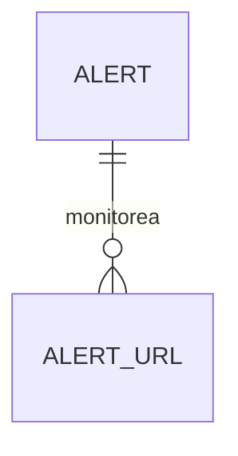

# md-to-latex: de Markdown a PDF con portada

Convierte archivos Markdown (`header.md` + `body.md`) en un documento **LaTeX** (`.tex`) y lo compila a **PDF** con portada institucional, índice, encabezado, pie de página, tablas, código, ecuaciones, imágenes y diagramas Mermaid.

---

## Requisitos

| Requisito | Para qué | Obligatorio |
|---|---|---|
| Python 3 (probado con 3.14) | Ejecutar el script (solo librería estándar, no hay que instalar nada) | Sí |
| TeX Live / MacTeX (`pdflatex`) | Compilar el `.tex` a PDF | Sí, salvo que uses `--no-compile` |
| Google Chrome (o Chromium) | Renderizar los bloques ` ```mermaid ` | Solo si hay diagramas Mermaid |
| `pdfcrop` (viene con TeX Live) | Recortar los diagramas Mermaid | Solo si hay diagramas Mermaid |

Paquetes de LaTeX que usa el documento generado (ya incluidos en TeX Live completo): `babel`, `geometry`, `fancyhdr`, `titlesec`, `hyperref`, `listings`, `longtable`, `booktabs`, `ragged2e`, `zref-totpages`, `xcolor`, `graphicx`, `amsmath`.

---

## Estructura

```
md-to-latex/
├── md_to_latex.py           # Script de conversión y compilación
├── test_md_to_latex.py      # Pruebas unitarias
├── README.md
├── templates/
│   └── mermaid.min.js       # Mermaid local (lo usa Chrome para renderizar diagramas)
├── examples/                # Ejemplo completo y público (es lo que se sube a Git)
│   ├── header.md            # Metadatos de la portada (datos ficticios)
│   ├── body.md              # Contenido: texto, tablas, código, ecuaciones, imagen y Mermaid
│   └── img/                 # Imágenes; aquí también se guardan los diagramas Mermaid generados
└── sources/                 # Tus documentos privados (ignorada por git, no se sube)
```

> **Privacidad:** `sources/` está en el `.gitignore`. Pon ahí tus propios `header.md`, `body.md` e imágenes.
> Para probar la herramienta sin crear nada, usa `python3 md_to_latex.py examples/`.

---

## Validación de entradas

Antes de convertir nada, el script comprueba las entradas y, si algo falla, termina con código `1` y lista **todos** los problemas a la vez:

- **Body (obligatorio):** debe existir, ser un archivo y no estar vacío. Se toma de `--body`, del archivo `.md` indicado, o de `body.md` en la carpeta de fuentes (o en el directorio actual).
- **Header:** si pasas `--header`, debe existir y tener contenido. Si no lo pasas, se usa `header.md` de la carpeta de fuentes. Si no hay ninguno, el script avisa y los metadatos de la portada deben venir del frontmatter del body o de `--titulo`, `--autor`, `--institucion`...
- **Carpeta de fuentes:** si la indicas con `--source-dir` o como argumento, debe existir.
- **Metadatos de la portada:** título, autor e institución/asignatura siguen validándose después (código `2` si faltan).

---

## Cómo ejecutar

Todos los comandos se ejecutan desde la carpeta `md-to-latex/`:

```bash
cd <ruta-del-proyecto>/md-to-latex
```

### Uso básico

Genera el `.tex` y el PDF. Sin `--output`, el resultado se llama `documento.tex` / `documento.pdf`:

```bash
python3 md_to_latex.py examples/
```

Equivalente, sin argumentos: usa `sources/` si existe (tu carpeta privada); si no, busca `body.md` y `header.md` en el directorio actual:

```bash
python3 md_to_latex.py
```

### Nombre de salida

Con `--output` se genera **solo** ese archivo; no se crea `documento.*`. La extensión es opcional (`.pdf` y `.tex` se ignoran y se agregan las dos):

```bash
python3 md_to_latex.py sources/ --output entregable-avances-01
```

También acepta una ruta (la carpeta debe existir):

```bash
python3 md_to_latex.py sources/ --output ../entregas/entregable-avances-01
```

### Solo generar el `.tex` (sin compilar)

Útil para revisar el LaTeX o compilarlo a mano:

```bash
python3 md_to_latex.py sources/ --no-compile
```

### Verificar la portada antes de generar

Comprueba que el `header.md` tenga lo indispensable (título, autor y asignatura o institución). Imprime `READY` (código de salida 0) o `MISSING:<campos>` (código 2):

```bash
python3 md_to_latex.py sources/ --check-only
```

### Otra carpeta de fuentes, otro `header` u otro `body`

```bash
python3 md_to_latex.py --source-dir otra-carpeta/
```

```bash
python3 md_to_latex.py sources/ --header sources/header-alterno.md
```

```bash
python3 md_to_latex.py --body sources/body1.md --header sources/header.md
```

Si pasas un archivo `.md` como argumento, se usa como cuerpo y su carpeta como carpeta de fuentes:

```bash
python3 md_to_latex.py sources/body1.md
```

### Sobrescribir datos de la portada desde la línea de comandos

Los argumentos tienen prioridad sobre lo que diga `header.md`:

```bash
python3 md_to_latex.py sources/ --titulo "Mi título" --subtitulo "Mi subtítulo" --autor "Nombre Apellido" --fecha "Noviembre 2026"
```

```bash
python3 md_to_latex.py sources/ --institucion "Universidad X" --area "Facultad de Ingeniería" --departamento "Arquitectura de Sistemas"
```

### Referencia de argumentos

| Argumento | Descripción |
|---|---|
| `target` (posicional) | Carpeta de fuentes (`sources/`, `examples/`...) o archivo `.md` de contenido |
| `--source-dir`, `-s` | Carpeta con los archivos de origen (`.md`, imágenes) |
| `--header` | Ruta del archivo de metadatos (por defecto `header.md` en la carpeta de fuentes) |
| `--body` | Ruta del archivo de contenido (por defecto `body.md`) |
| `--output`, `-o` | Nombre o ruta de salida, sin crear el nombre por defecto |
| `--titulo`, `--subtitulo`, `--autor`, `--institucion`, `--area`, `--departamento`, `--fecha` | Datos de la portada (pisan a `header.md`) |
| `--check-only` | Solo valida la portada y sale (0 = lista, 2 = faltan datos) |
| `--no-compile` | Genera el `.tex` pero no el PDF |

### Compilar a mano un `.tex` ya generado

El script ya hace estas dos pasadas; sirve para depurar errores (aparecen como líneas que empiezan con `!`):

```bash
pdflatex -interaction=nonstopmode documento.tex
```

```bash
pdflatex -interaction=nonstopmode documento.tex
```

Alternativa con `latexmk`:

```bash
latexmk -pdf -interaction=nonstopmode documento.tex
```

---

## Pruebas unitarias

Protegen los comportamientos que ya se rompieron alguna vez al modificar el script (escapes, numeración, tablas, encabezado/pie, nombres de salida, compilación real). Usan `unittest`, que viene con Python:

```bash
python3 -m unittest -v test_md_to_latex
```

Una sola clase o una sola prueba:

```bash
python3 -m unittest -v test_md_to_latex.TableTests
```

```bash
python3 -m unittest -v test_md_to_latex.HeadingTests.test_cuerpo_sin_h1_arranca_en_seccion_1
```

La prueba de compilación real se omite sola si no hay `pdflatex`. Las pruebas **no** cubren Mermaid (depende de Chrome) ni el aspecto visual del PDF: eso se revisa abriendo el resultado. **Ejecútalas antes de dar por buena cualquier modificación a `md_to_latex.py`.**

---

## Formato de `header.md`

Pares `clave: valor`, con o sin delimitadores `---`. Las líneas que empiezan con `#` son comentarios. Cada clave con valor se muestra como una fila en la tabla de la portada.

```markdown
---
titulo: "Diseño e implementación parcial mediante un corte vertical por capas"
subtitulo: "Avances Implementación Corte Vertical"
asignatura: "Arquitectura de Sistemas I (Período 2026-2) — Universidad X"
docente: "Prof. Nombre Apellido"
autor: "Nombre Apellido / CC. 123456789"
fecha: "Noviembre 2026"
---
```

| Clave | Uso |
|---|---|
| `titulo`, `subtitulo` | Título grande de la portada (el título es obligatorio) |
| `autor` | Obligatorio |
| `asignatura` (o `materia`) | Obligatorio si no hay `institucion`. Aparece en la portada y en el encabezado |
| `institucion`, `area`, `departamento` | Encabezado institucional de la portada |
| `docente`, `repositorio`, `periodo`, `codigo`, `fecha` | Filas de la tabla de metadatos |
| otras claves | Se agregan como fila con la clave como etiqueta |

El `body.md` también puede traer su propio bloque `---` al inicio con estos datos.

Si falta algo indispensable, el script se detiene con código 2 y lista lo que falta.

---

## Qué se genera en el PDF

- **Portada** (sin encabezado ni pie) con la tabla de metadatos.
- **Índice automático.** La numeración de páginas arranca en 1 en el índice; la portada no cuenta. Pie: `Página X de Y`.
- **Encabezado** de las páginas interiores: asignatura (izquierda) y fecha (derecha).
- Secciones numeradas desde 1.

---

## Sintaxis de Markdown soportada

| Elemento | Cómo escribirlo | Notas |
|---|---|---|
| Títulos | `#`, `##`, `###`, `####` | Si el cuerpo no tiene `#`, el nivel más alto pasa a ser la sección 1 |
| Numeración manual | `## 3 · Título`, `## 2.1. Título`, `## 4) Título` | LaTeX ya numera: el prefijo se elimina solo |
| Índice manual | Lista inicial de enlaces `[texto](#ancla)` | Se omite para no duplicar el índice automático |
| Énfasis | `**negrita**`, `*cursiva*`, `***ambas***` | |
| Código en línea | `` `texto` `` | En tablas se parte si no cabe |
| Bloques de código | ` ```python ` … ` ``` ` | Con resaltado para `python`, `java`, `sql`, `bash`, `xml`, `html`, `js`, `c`, `cpp`; otros lenguajes salen sin resaltado |
| Matemáticas | `$x^2$` en línea; `$$` … `$$` en bloque | |
| Listas | `-`, `*`, `+` o `1.` | |
| Tablas | `\| a \| b \|` con fila `\|---\|---\|` | Anchos automáticos, salto de línea con `<br>` |
| Citas | `> texto` | |
| Enlaces | `[texto](https://…)` | |
| Imágenes | `` | La descripción es el pie de figura |
| Diagramas | ` ```mermaid ` … ` ``` ` | Se renderizan como PDF vectorial |
| Regla horizontal | `---` | |
| Escapes | `\_`, `\#`, `\{`, `\}` … | Se respetan |

### Imágenes

Se buscan automáticamente en `sources/`, `sources/img/`, `sources/imagenes/`, `sources/images/` y `sources/assets/`:

```markdown

```

O solo por nombre si está en una de esas carpetas:

```markdown

```

### Diagramas Mermaid

Escribe el diagrama en un bloque de código con lenguaje `mermaid`:

````markdown

````

- Se genera un PDF por diagrama en `sources/img/mermaid_<hash>.pdf`.
- **Caché:** si el código del diagrama no cambió, se reutiliza el PDF y no se abre Chrome. Una ejecución con diagramas sin cambios tarda ~1,5 s en vez de ~4,5 s.
- Si cambias cómo se renderiza Mermaid (tema, márgenes) en el script, sube `MERMAID_RENDER_VERSION` en `md_to_latex.py` para invalidar la caché.
- Los PDF de diagramas que ya no uses quedan en `sources/img/`; puedes borrarlos a mano.
- Si Chrome no está disponible o el diagrama tiene un error de sintaxis, se avisa y el bloque se incluye como código.

---

## Solución de problemas

| Síntoma | Causa probable | Qué hacer |
|---|---|---|
| `Error en la compilación LaTeX` | Contenido que genera LaTeX inválido | Ejecuta con `--no-compile`, compila a mano y busca las líneas que empiezan con `!` |
| `Unicode character … not set up for use with LaTeX` | Símbolo Unicode sin declarar | Declararlo en el preámbulo (`\DeclareUnicodeCharacter`) dentro de `md_to_latex.py`. Ya están `≤ ≥ ≠ ≈ → ← ↔ ×` |
| Un diagrama sale como código | Chrome no está en la ruta esperada o el diagrama tiene error | Revisa que exista `/Applications/Google Chrome.app` y la sintaxis Mermaid |
| Una espera larga en un diagrama | Error de sintaxis en Mermaid: Chrome espera hasta 15 s | Corrige el diagrama |
| `Faltan los siguientes datos indispensables` | Falta título, autor o asignatura/institución | Completa `header.md` o usa los argumentos `--titulo`, `--autor`… |
| El índice dice `0.1`, `0.2` | Versión anterior del script | Actualmente se corrige solo; si reaparece, ejecuta las pruebas |
| Una palabra se sale de su celda | Columna muy angosta | Revisa `close_table` en `md_to_latex.py` y las pruebas de `TableTests` |

---

## Archivos generados

Con el nombre por defecto: `documento.tex` y `documento.pdf` en la carpeta desde donde ejecutas el comando. Los auxiliares de LaTeX (`.aux`, `.log`, `.out`, `.toc`) se borran al terminar con éxito; si la compilación falla se conservan para depurar.
