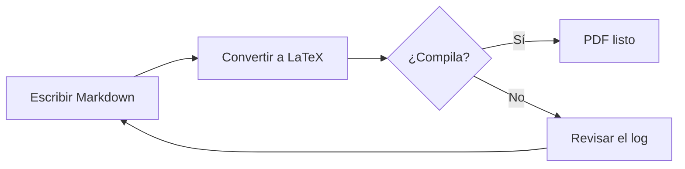
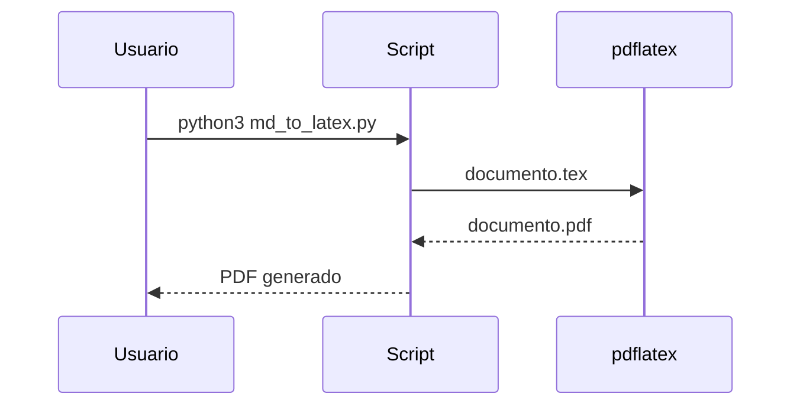

# Introducción

Este documento de **demostración** muestra todo lo que `md_to_latex.py` sabe convertir: texto con *énfasis*, ***negrita e itálica***, listas, tablas, código, ecuaciones, imágenes y diagramas Mermaid. Todos los datos son ficticios.

Puedes consultar el [repositorio de Mermaid](https://mermaid.js.org) o escribir a [contacto](mailto:nombre@ejemplo.com). Los caracteres especiales de LaTeX como 50%, R&D, #1, a_b y \$5 se escapan solos.

> El mejor documento es el que se puede regenerar con un solo comando.

---

# Texto y listas

## Listas

Lista con viñetas:

- Primer elemento con `código en línea`
- Segundo elemento con **negrita**
- Tercer elemento con una ruta como `sources/img/diagrama.png`

Lista numerada:

1. Escribir `header.md` con los metadatos de la portada.
2. Escribir `body.md` con el contenido.
3. Ejecutar el script y revisar el PDF.

## Niveles de títulos

### Tercer nivel

Texto bajo un título de tercer nivel.

#### Cuarto nivel

Los títulos de cuarto nivel se convierten en párrafos con título.

# Tablas

La primera columna es la más corta y la última la más larga; el script reparte los anchos según el contenido.

| Módulo | Responsabilidad | Observaciones |
|---|---|---|
| `core` | Reglas de negocio y acceso a la base de datos | Expone la API principal y valida cada entrada |
| `notify` | Envío de correos | Reintenta hasta 3 veces<br>Registra cada intento |
| `schedule` | Programación de tareas | Máximo 2 ejecuciones al día |

# Código

Los bloques con lenguaje conocido se resaltan:

```python
def promedio(valores):
    """Devuelve el promedio de una lista de números."""
    if not valores:
        return 0
    return sum(valores) / len(valores)
```

```sql
SELECT name, COUNT(*) AS total
FROM alerts
WHERE active = true
GROUP BY name;
```

```bash
python3 md_to_latex.py examples/
```

Un bloque sin lenguaje se imprime tal cual, sin resaltado:

```
Línea 1 con acentos: canción, año, ¿qué tal?
Línea 2
```

# Ecuaciones

Una fórmula en línea, como $E = mc^2$ o $\alpha + \beta \leq \gamma$, se integra con el texto.

Una ecuación en bloque:

$$
\bar{x} = \frac{1}{n} \sum_{i=1}^{n} x_i
$$

Y un sistema alineado:

$$
\begin{aligned}
f(x) &= x^2 + 2x + 1 \\
     &= (x + 1)^2
\end{aligned}
$$

# Imágenes

Las imágenes se buscan en la carpeta de fuentes y en `img/`. El texto alternativo se usa como pie de figura:


# Diagramas Mermaid

Los bloques de código con lenguaje `mermaid` se renderizan como PDF vectorial con Chrome y se guardan en `img/` para no volver a generarlos si no cambian.





# Cierre

Con este ejemplo puedes comprobar que tu instalación funciona: si el PDF se genera con portada, índice, tablas, ecuaciones y diagramas, todo está listo para tus propios documentos.
